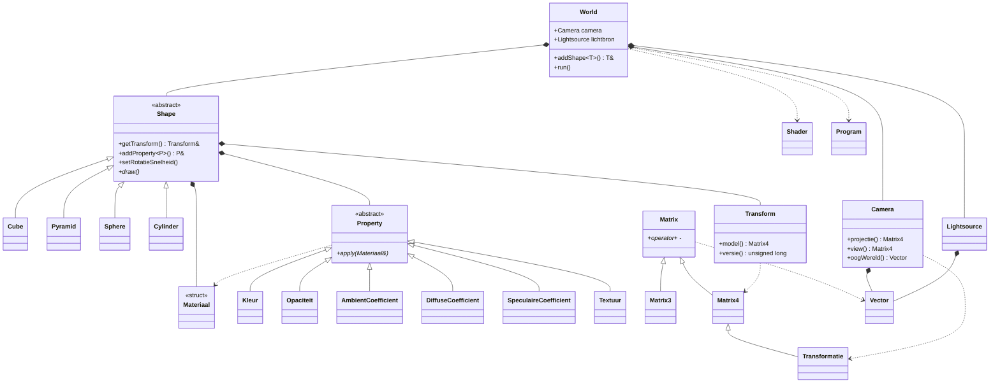

# Engine v2

Een kleine 3D-graphics engine in C++ met OpenGL, gebouwd voor het vak High Performance Computing (TINHPC). De engine gebruikt geen externe wiskundebibliotheek zoals GLM: alle vector- en matrixberekeningen zitten in een eigen `Vector`- en `Matrix`-library. De engine is een library: je compileert hem mee met een eigen programma (zoals `demo.cpp`) dat vormen toevoegt en `run()` aanroept.

## Bestandsstructuur

| Bestand                                       | Inhoud                                                                                                                                                     |
| --------------------------------------------- | ---------------------------------------------------------------------------------------------------------------------------------------------------------- |
| `engine.hpp` / `engine.cpp`               | `World`-class: venster, shaders, vormen, invoer, tekenloop, meting                                                                                       |
| `shapes.hpp` / `shapes.cpp`               | `Shape`-parent class met subclasses `Cube`, `Pyramid`, `Sphere`, `Cylinder`                                                                      |
| `shapes.h`                                  | Vertexdata (positie, normaal, uv) voor kubus en piramide                                                                                                   |
| `properties.hpp` / `properties.cpp`       | `Materiaal` en de `Property`-classes: `Kleur`, `Opaciteit`, `AmbientCoefficient`, `DiffuseCoefficient`, `SpeculaireCoefficient`, `Textuur` |
| `shaders.hpp` / `shaders.cpp`             | `Shader` en `Program`: compileren en linken van GLSL                                                                                                   |
| `camera.hpp` / `camera.cpp`               | `Camera`: positie, oriëntatie en de vier projectiematrices                                                                                              |
| `lightsource.hpp` / `lightsource.cpp`     | `Lightsource`: positie en kleur van de lichtbron                                                                                                         |
| `transformatie.hpp` / `transformatie.cpp` | `Transform`: schaling, rotatie en translatie van een vorm                                                                                                |
| `matrix.hpp` / `matrix.cpp`               | `Matrix`, `Matrix3`, `Matrix4`, `Transformatie`                                                                                                    |
| `vector.hpp` / `vector.cpp`               | `Vector` (n-dimensionaal)                                                                                                                                |
| `demo.cpp`                                  | `main()`: bouwt een voorstelling op en start de tekenloop                                                                                                |
| `stb_image.h`                               | Texture-loading (header-only)                                                                                                                              |

`draw.h` en `draw.cpp` (de 2D-wrapper van school) horen niet bij de engine en worden niet meegecompileerd.

## Bouwen

Vanuit de map waar `demo.cpp` staat:

```bash
g++ demo.cpp "Engine v2\engine.cpp" "Engine v2\shapes.cpp" "Engine v2\shaders.cpp" 
    "Engine v2\properties.cpp" "Engine v2\matrix.cpp" "Engine v2\vector.cpp" 
    "Engine v2\transformatie.cpp" "Engine v2\camera.cpp" "Engine v2\lightsource.cpp" 
    -o demo.exe -I"Engine v2" -lglfw3 -lglew32 -lopengl32 -lgdi32
```

Vereist: GLFW3, GLEW en een OpenGL-context van minimaal 3.3 core. Let op: `properties.cpp` is nieuw ten opzichte van de vorige versie en moet in de compileerregel staan.

## Gebruik

Een programma maakt een `World` aan, voegt vormen toe met `addShape`, stelt eigenschappen en transformaties in en roept `run()` aan:

```cpp
#include "engine.hpp"

int main() {
    World wereld(800, 600, "Mijn scene");

    Cube &kubus = wereld.addShape<Cube>();
    kubus.getTransform().setTranslatie(-1.2f, 0.0f, 0.0f);
    kubus.getTransform().setSchaal(1.5f);
    kubus.setRotatieSnelheid(0.0f, 1.0f, 0.0f);          // draait om de y-as
    kubus.addProperty<Kleur>(1.0f, 0.2f, 0.2f);          // rood
    kubus.addProperty<Opaciteit>(0.5f);                  // half doorzichtig

    Sphere &bol = wereld.addShape<Sphere>();
    bol.addProperty<Textuur>("texture.png");

    wereld.camera.setPositie(Vector({0, 1, 2}));
    wereld.camera.setOrientatie(0.3f, -0.2f);            // yaw, pitch in radialen
    wereld.lichtbron.setPositie(Vector({2, 3, 1}));
    wereld.lichtbron.setKleur(1.0f, 0.9f, 0.8f);

    wereld.run();
    return 0;
}
```

- `addShape<T>(...)` is een template: `T` is `Cube`, `Pyramid`, `Sphere` of `Cylinder` (of een eigen subclass van `Shape`). Extra argumenten gaan naar de constructor, bijvoorbeeld `addShape<Cylinder>(12)` voor 12 segmenten. Er is geen maximum aantal vormen.
- `addProperty<P>(...)` is ook een template en werkt het materiaal van de vorm meteen bij. Een latere eigenschap van hetzelfde soort overschrijft een eerdere.
- Alle afmetingen zijn in wereldeenheden, hoeken in radialen.
- Fouten (venster, shaders, texture, ongeldige waarden) komen als `std::exception` naar buiten; vang ze op in `main()` zoals `demo.cpp` doet.

## Vormen

| Vorm         | Afmetingen (zonder schaling)                                     |
| ------------ | ---------------------------------------------------------------- |
| `Cube`     | middelpunt (0, 0, 0), ribbelengte 1                              |
| `Pyramid`  | vierkant grondvlak met ribbelengte 1 rond (0, -0.5, 0), hoogte 1 |
| `Cylinder` | middelpunt (0, 0, 0), hoogte 1, diameter 1, as langs y           |
| `Sphere`   | middelpunt (0, 0, 0), diameter 1                                 |

Elke vorm heeft een eigen `Transform` (schaling in x, y en z; translatie in x, y en z; rotatie om x, y en z) en een eigen `Materiaal`. De modelmatrix is `T · Rz · Ry · Rx · S`, dus een vorm draait om zijn eigen middelpunt.

## Eigenschappen

Eigenschappen zijn subclasses van de abstracte class `Property`. Elke subclass past een deel van het `Materiaal` aan:

| Property                  | Constructor                | Effect                                                                                     |
| ------------------------- | -------------------------- | ------------------------------------------------------------------------------------------ |
| `Kleur`                 | `Kleur(r, g, b)`         | RGB-kleur van het oppervlak (0 tot 1)                                                      |
| `Opaciteit`             | `Opaciteit(alpha)`       | 1.0 is ondoorzichtig, 0.0 onzichtbaar                                                      |
| `AmbientCoefficient`    | `(r, g, b)`              | ambient reflectiecoëfficiënt: kleur in de schaduw, houd hem donker (10–20% van diffuse) |
| `DiffuseCoefficient`    | `(r, g, b)`              | diffuse reflectiecoëfficiënt: de hoofdkleur onder direct licht                           |
| `SpeculaireCoefficient` | `(r, g, b, shininess)`   | glans; 8 = groot en zacht, 128 = klein en scherp                                           |
| `Textuur`               | `Textuur("bestand.png")` | bitmap op de vorm, met eigen bitmap per vorm                                               |

Waarden buiten 0 tot 1 geven een `std::invalid_argument`. Een eigen eigenschap toevoegen kan door van `Property` te erven en `apply(Materiaal &)` te implementeren; `Shape` hoeft daarvoor niet aangepast te worden.

## Texture

Een `Textuur` leest de bitmap in via `stb_image` (altijd als RGB, ook als het bestand een alfa-kanaal heeft), maakt mipmaps aan en gebruikt texture unit 0. Het pad is relatief aan de map waar je `demo.exe` start, dus niet aan `Engine v2`. Ontbreekt het bestand, dan gooit de constructor een `runtime_error`. De textuur wordt vrijgegeven wanneer de vorm verdwijnt. Er moet al een `World` bestaan voordat je een `Textuur` aanmaakt, omdat er een GL-context nodig is.

## Camera en lichtbron

`Camera` bewaart een positie, een oriëntatie (yaw en pitch), een field of view, een aspect en near/far-vlakken. De view-matrix is `naarOog · pitch · yaw · terug`, met `terug = translatie(0, 0, -3)`: bij positie (0, 0, 0) staat het oog dus op (0, 0, 3) in de wereld. De positie en oriëntatie kunnen bij het aanmaken en daarna met `setPositie`, `beweeg`, `setOrientatie` en `draai` worden ingesteld. Een rotatie om de z-as (roll) wordt niet ondersteund. De pitch wordt begrensd op ±1,5 rad.

`Lightsource` heeft een positie en een RGB-kleur. De shader gebruikt beide, plus de echte oogpositie (`Camera::oogWereld()`) voor de speculaire berekening, zodat de glans klopt als de camera beweegt.

## Projecties

`Camera::setProjectieType` wisselt tussen vier projecties; perspectief is de standaard.

| Toets | Projectie     | Opbouw                                                       |
| ----- | ------------- | ------------------------------------------------------------ |
| `1` | orthografisch | `glOrtho`-achtige matrix                                   |
| `2` | parallel      | oblique (cabinet) shear bovenop de ortho-matrix              |
| `3` | isometrisch   | 45° om y en ca. 35,264° om x, bovenop de ortho-matrix      |
| `4` | perspectief   | standaard OpenGL-perspectiefmatrix met `nearZ` en `farZ` |

De klassieke schoolmatrices zetten z op 0. Dat is hier bewust niet gedaan: met `GL_DEPTH_TEST` krijgt dan elk fragment dezelfde diepte en bepaalt de tekenvolgorde wat zichtbaar is. De varianten hier behouden z, zodat de dieptetest blijft werken. De schaal van ortho, parallel en isometrisch is afgeleid uit de field of view en de kijkafstand 3, zodat het beeld bij wisselen ongeveer even groot blijft.

## Besturing

| Toets                     | Actie                                                        |
| ------------------------- | ------------------------------------------------------------ |
| `W` / `S`             | camera vooruit / achteruit                                   |
| `A` / `D`             | camera links / rechts                                        |
| `Q` / `E`             | camera omhoog / omlaag                                       |
| Pijltjes                  | camera draaien (yaw en pitch)                                |
| `Shift` + pijltjes      | lichtbron in x en y                                          |
| `Shift` + `W` / `S` | lichtbron in -z / +z                                         |
| `1` `2` `3` `4`   | projectie wisselen                                           |
| `P`                     | animatie pauzeren / hervatten                                |
| `B`                     | wisselen tussen geoptimaliseerd en naïef (zie Efficiëntie) |
| `V`                     | vsync aan / uit                                              |

Alle snelheden zijn per seconde (camera 6 eenheden/s, kijken 1,2 rad/s, licht 3 eenheden/s), dus de besturing hangt niet af van de framerate.

## Features

**Eigen wiskunde.** `Vector` ondersteunt optellen, aftrekken, scalair vermenigvuldigen en delen, inproduct, uitproduct en normaliseren. `Matrix` ondersteunt optellen, aftrekken, vermenigvuldigen met een matrix en met een vector, transponeren, determinant en inverse. `Matrix4` en `Transformatie` leveren translatie-, schaal-, rotatie- en perspectiefmatrices in homogene coördinaten.

**Per-object transformatie.** Elke vorm heeft een eigen modelmatrix, opgebouwd uit translatie, schaling en rotatie. Met `setRotatieSnelheid` draait een vorm vanzelf.

**Belichting (Phong).** Ambient, diffuse en specular met een instelbare shininess, berekend per fragment, met de positie en kleur van de lichtbron en de echte oogpositie.

**Transparantie.** Vormen met `alpha < 1.0` worden in twee passes getekend: eerst alle ondoorzichtige, daarna de transparante, van ver naar dichtbij gesorteerd, met blending aan en diepteschrijven uit. Zo blijft de achterkant van een transparant object zichtbaar.

**Normal perturbation.** De normaal wordt in de fragment-shader verstoord met een sinuspatroon in objectruimte, waardoor het oppervlak reliëf lijkt te hebben zonder dat de geometrie verandert.

**Texture mapping.** Elke vorm kan een eigen bitmap krijgen. Bol en cilinder hebben uv-coördinaten; een vorm zonder `Textuur` gebruikt zijn kleur.

## Efficiëntie

- `projectie · view` wordt één keer per frame berekend en als één uniform (`viewProjection`) naar de shader gestuurd.
- Elke vorm cachet zijn modelmatrix. `Transform` heeft een versieteller die alleen oploopt als een waarde echt verandert; de modelmatrix wordt alleen opnieuw berekend bij een nieuwe versie. Bij gepauzeerde animatie (`P`) komt dus elke modelmatrix uit de cache.
- Toets `B` schakelt naar een naïeve modus die alles per vorm opnieuw berekent, zodat je het verschil kunt meten.
- Elke 1000 frames print de console de gemiddelde frametijd en de gemiddelde `render()`-tijd (CPU) in milliseconden, met de huidige modus. De render-tijd laat de winst het zuiverst zien, omdat de frametijd ook door de GPU bepaald wordt. Vsync staat standaard uit (toets `V`), anders meet je alleen de refreshrate.

## Klassendiagram



## Design patterns

| Pattern                  | Waar                                                                            | Waarom                                                                                                                                                                                                              |
| ------------------------ | ------------------------------------------------------------------------------- | ------------------------------------------------------------------------------------------------------------------------------------------------------------------------------------------------------------------- |
| Facade                   | `World`                                                                       | De gebruiker hoeft niets van GLFW, GLEW, shaders of de tekenloop te weten: `World`, `addShape` en `run` volstaan.                                                                                             |
| Template Method          | `Shape`                                                                       | `Shape::upload()` doet het vaste werk (VAO, VBO, attributen); elke subclass levert alleen zijn vertices en een eigen `draw()`. Nieuwe vormen vragen dus weinig code.                                            |
| Strategy (lichte vorm)   | `Property`                                                                    | Elke eigenschap bepaalt zelf hoe zij het materiaal aanpast via een virtuele `apply()`. `Shape` behandelt ze allemaal hetzelfde, dus nieuwe eigenschappen kosten geen aanpassing in `Shape` of de shader-code. |
| Factory Method           | `Transformatie::translatie/rotatie/schaling/perspectief`, `World::addShape` | De aanroeper hoeft geen enum-parameters of GL-programma's door te geven; de factory kiest en bouwt het juiste object.                                                                                               |
| RAII                     | `Shader`, `Program`, `Shape`, `Textuur`                                 | GPU-resources worden in de destructor vrijgegeven en de classes zijn niet kopieerbaar, zodat een handle nooit twee eigenaren heeft.                                                                                 |
| Caching met versieteller | `Transform` en `Shape::getModel()`                                          | De modelmatrix wordt alleen herberekend als de transformatie echt verandert. Dit is geen GoF-pattern, maar een bewuste optimalisatie die in de meting zichtbaar is.                                                 |

Vormen en eigenschappen worden bewaard in `std::unique_ptr` zodat polymorfe objecten zonder slicing in één `std::vector` kunnen staan en `World` of `Shape` de eigenaar is.

## Moderne C++-features

- **Templates:** `World::addShape<T>` en `Shape::addProperty<P>`, beide variadisch met perfect forwarding en een `static_assert` op de basisclass.
- **Virtual functions:** `Shape::draw()` en `Property::apply()`.
- **References:** `addShape` en `addProperty` geven een referentie terug; parameters zijn `const &`.
- **Smart pointers:** `std::unique_ptr` en `std::make_unique`.
- **Overloaded operatoren:** `+`, `-`, `*`, `==`, `!=`, `<<` op `Matrix`; `+`, `-`, `*`, `/`, `==`, `!=`, `<<` op `Vector`.

## Bekende beperkingen

- Een rotatie van de camera om de z-as (roll) is er niet.
- Er is één lichtbron.
- Er is nog geen muisinput.
- De normaalmatrix is `mat3(model)`: bij niet-uniforme schaling kloppen de normalen niet.
- Uniform-locaties worden elk frame opnieuw opgevraagd (niet gecachet).
- Transparante vormen worden per vorm gesorteerd, niet per driehoek; twee elkaar doordringende transparante vormen kunnen daardoor fout gemengd worden.
